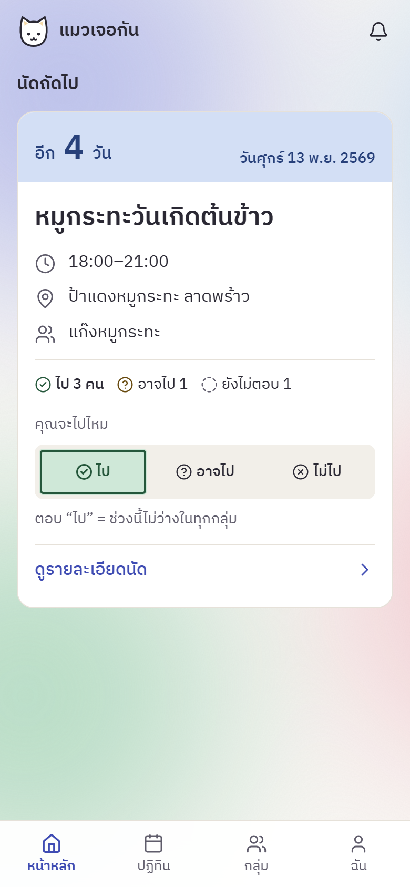
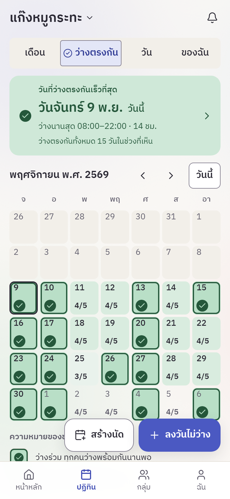

<p align="center">
  <picture>
    <source media="(prefers-color-scheme: dark)" srcset="docs/images/logo-dark.svg">
    
  </picture>
</p>

<p align="center">
  <a href="https://github.com/ieatbaozi-stack/maewmeet/actions/workflows/ci.yml"></a>
</p>

<p align="center">
  <strong>แมวเจอกัน (maewmeet)</strong> — เว็บแอปนัดหมายกลุ่มเพื่อน<br>
  <em>A group scheduling web app: mark when you're busy, find the days everyone is free, then set up the meetup.</em>
</p>

ลงว่าวันไหนไม่ว่าง ระบบหาวันที่ทุกคนว่างตรงกัน แล้วสร้างนัด (กินข้าว เที่ยว หรือกิจกรรมอื่นๆ) พร้อมสถานที่และเวลา ใช้บนมือถือเป็นหลัก ใช้ได้ทั้งภาษาไทยและอังกฤษ และมีธีมสว่างกับมืด

**เว็บที่ใช้งานจริง:** https://maewmeet.vercel.app

## ภาพหน้าจอ

<table>
  <tr>
    <td align="center"><br><sub>หน้าหลัก: นัดถัดไปและการตอบรับ</sub></td>
    <td align="center"><br><sub>ปฏิทิน: แท็บ "ว่างตรงกัน"</sub></td>
  </tr>
</table>

## วิธีใช้

1. เข้าบัญชี (สมัครด้วยชื่อผู้ใช้และ PIN 6 หลัก)
2. สร้างกลุ่มใหม่ หรือเข้ากลุ่มที่มีอยู่แล้ว
3. ชวนเพื่อนเข้ากลุ่ม ด้วยชื่อผู้ใช้ หรือโค้ดเชิญ
4. ลงวันที่ไม่ว่างของตัวเอง
5. ดูแท็บ "ว่างตรงกัน" ในปฏิทินเพื่อหาวันที่ทุกคนว่างพร้อมกัน
6. สร้างนัดจากวันนั้น แล้วเพื่อนตอบ ไป / อาจไป / ไม่ไป

รายละเอียดครบทุกขั้นอยู่ใน [คู่มือเริ่มต้นใช้งาน (ภาษาไทย)](docs/guides/quickstart-th.html) — ไฟล์นี้เป็น HTML ดาวน์โหลดมาแล้วเปิดในเบราว์เซอร์ได้เลย (GitHub จะแสดงเป็นโค้ดถ้าเปิดในหน้าเว็บ)

## ฟีเจอร์

- **ลงวันไม่ว่าง** ทั้งวัน (วันเดียวหรือหลายวัน) หรือเฉพาะช่วงเวลาในแต่ละวัน (เช่น 17:00–20:00 ทุกวันในช่วงที่กำหนด) และลบได้ทั้งวันเดียวหรือทั้งชุด
- **แบบประจำ** ลงวันที่ไม่ว่างซ้ำเป็นชุดได้ครั้งเดียว: เลือกวันในสัปดาห์ (เช่น จ.–ศ.) เวลาหรือทั้งวัน และช่วงเป็นสัปดาห์หรือเดือน มีปุ่มลัด เช่น ทำงาน เรียน/คลาส ยิม เสาร์–อาทิตย์ และ “ทั้งเดือนนี้” · ชุดหนึ่งยาวได้ไม่เกิน 26 สัปดาห์ หรือ 6 เดือน และลงได้ไม่เกิน 10 ชุดที่ยังไม่จบต่อคน · แก้หรือลบได้ทีละเฉพาะวันนี้ ตั้งแต่สัปดาห์/เดือนที่เลือกไป หรือทั้งชุด · คนอื่นในทุกกลุ่มที่คุณอยู่เห็นทุกวันของชุดเป็นช่วงไม่ว่างพร้อมเวลา โดยไม่รู้ว่ามาจากแบบประจำ
- **ปฏิทินกลุ่ม** มุมมองเดือน วัน และแท็บ "ว่างตรงกัน" ที่บอกวันที่ว่างตรงกันเร็วที่สุด
- **นัด** สร้าง แก้ไข ยกเลิก และตอบรับ ไป / อาจไป / ไม่ไป พร้อมเตือนเมื่อเวลาชนกับนัดหรือช่วงไม่ว่างที่ลงไว้
- **เพิ่มนัดลงปฏิทินในเครื่อง** หลังตอบ "ไป" กด "เพิ่มลงปฏิทินในเครื่อง" ในหน้านัด แล้วเลือกปฏิทินในเครื่อง (ไฟล์ .ics) หรือ Google Calendar · ถ้านัดมีลิงก์แผนที่ ลิงก์นั้นจะอยู่ในช่อง URL ของรายการในปฏิทิน และในรายละเอียดมีป้าย “แผนที่:” (อาจมีพิกัดของสถานที่; iPhone อาจแสดงลิงก์ในช่อง Location แทน ยังไม่ยืนยันบนเครื่องจริง) · เป็นการคัดลอกครั้งเดียว ถ้านัดเลื่อนหรือยกเลิกทีหลัง ปฏิทินจะไม่เปลี่ยนตาม ต้องแก้เอง · ถ้าเปิดในแอป LINE ให้เปิดในเบราว์เซอร์ก่อน
- **สถานที่และแผนที่** พิมพ์ชื่อสถานที่ แล้วกด Google Maps หรือ Apple Maps (บน iPhone/iPad/Mac) เพื่อหาที่ในแผนที่ จากนั้นกดแชร์ → คัดลอกลิงก์ แล้ววางในช่องลิงก์แผนที่ (ไม่บังคับ) · แอปไม่มีการค้นหาสถานที่และไม่มีภาพแผนที่
- **กลุ่ม** ตั้งชื่อกลุ่ม ชวนเพื่อนด้วยชื่อผู้ใช้หรือโค้ดเชิญ (โค้ดหมดอายุและเพิกถอนได้) ตั้งผู้ดูแลและผู้ช่วยดูแล นำสมาชิกออก โอนความเป็นผู้ดูแล ออกจากกลุ่ม และตั้งสี/รูปทรงของตัวเองในแต่ละกลุ่ม · ผู้ดูแลและผู้ช่วยดูแลตั้งช่วงเวลาที่นับว่าว่างได้
- **หน้าหลัก** นัดถัดไปพร้อมจำนวนคนที่ตอบไป และคำแนะนำเริ่มต้นใช้งานที่ปิดได้
- **แจ้งเตือนในแอป** ผ่านกระดิ่งและหน้าการแจ้งเตือน:
  - **นัด** นัดใหม่ในกลุ่ม · ยกเลิกนัด · เวลาหรือสถานที่เปลี่ยน (แก้แค่ชื่อหรือรายละเอียดไม่แจ้ง และยกเลิกหลังเริ่มนัดแล้วไม่แจ้ง) · เตือนก่อนนัด 1 วันและ 1 ชั่วโมงสำหรับคนที่ตอบ ไป · คนที่ตอบ อาจไป หรือยังไม่ตอบ จะได้คำถามยืนยันในกระดิ่ง 1 ครั้ง
  - **คำตอบนัด** ผู้สร้างนัดได้รับแจ้งเมื่อมีคนตอบหรือเปลี่ยนคำตอบในนัดที่ตัวเองสร้าง (ตอบครั้งแรกก็แจ้ง) ผู้สร้างตอบนัดของตัวเองไม่แจ้ง
  - **คำเชิญ** ได้รับคำเชิญเข้ากลุ่ม · ผู้เชิญได้รับแจ้งเมื่อคนนั้นรับหรือปฏิเสธ
  - **สมาชิกและสิทธิ์** ผู้ดูแลและผู้ช่วยดูแลได้รับแจ้งเมื่อมีคนเข้าหรือออกจากกลุ่ม · คนที่ถูกนำออกได้รับแจ้ง · คนที่สิทธิ์ในกลุ่มเปลี่ยนได้รับแจ้ง
  - **รีเซ็ต PIN** ผลคำขอ: ได้รับอนุมัติแล้ว หรือถูกยกเลิกเพราะเข้าสู่ระบบด้วย PIN เดิมได้
- **เตือนทาง LINE** (ไม่บังคับ) เชื่อมบัญชี LINE ที่แท็บ "ฉัน" แล้วรับข้อความเตือนก่อนนัดที่ตอบ ไป (1 วันและ 1 ชั่วโมง) และข้อความแจ้งเมื่อนัดนั้นถูกยกเลิก ทาง LINE OA "แมวเจอกัน" ข้อความมีแค่ชื่อนัด วันเวลา ชื่อกลุ่ม และลิงก์นัด ไม่มีชื่อคนที่ยกเลิก การเปลี่ยนเวลาหรือสถานที่ไม่ส่งทาง LINE · ยกเลิกการเชื่อมต่อได้ที่เดิม
- **บัญชี** เข้าสู่ระบบด้วยชื่อผู้ใช้และ PIN, เปลี่ยนชื่อที่แสดง, เปลี่ยน PIN, ออกจากระบบทุกเครื่อง, ขอรีเซ็ต PIN ผ่านผู้ดูแลระบบ, ดูหน้าความเป็นส่วนตัว และลบบัญชีได้เอง
- **ผู้ดูแลระบบ** (สำหรับ super admin) หน้าจัดการคำขอรีเซ็ต PIN, ค้นหาและระงับ/ปลดระงับ/ปลดล็อกผู้ใช้, ดูกลุ่ม และดู audit log
- **สองภาษาและสองธีม** ไทย/อังกฤษ และสว่าง/มืด (ตามระบบได้)

## Tech Stack

- [Next.js](https://nextjs.org/) (App Router) + [React](https://react.dev/) + [TypeScript](https://www.typescriptlang.org/)
- [Tailwind CSS](https://tailwindcss.com/)
- [Drizzle ORM](https://orm.drizzle.team/) + [Turso](https://turso.tech/) (libSQL)
- [next-intl](https://next-intl.dev/) สำหรับสองภาษา
- [Vitest](https://vitest.dev/) (unit/integration) และ [Playwright](https://playwright.dev/) (e2e)
- [Vercel](https://vercel.com/) สำหรับ deploy

## เริ่มต้นใช้งานในเครื่อง (Getting Started)

ต้องมี **Node 24** (ตามไฟล์ `.nvmrc`) และ git

```bash
git clone https://github.com/ieatbaozi-stack/maewmeet.git
cd maewmeet
npm ci
```

**1. สร้างไฟล์ env จากแม่แบบ** (คำสั่งเดียวกันใช้ได้ทั้ง PowerShell และ bash)

```bash
cp .env.example .env.local
```

**2. สร้างค่าสุ่มสำหรับความลับ** รันคำสั่งเหล่านี้แล้วคัดลอกผลลัพธ์ไว้ (รันคำสั่งแรกสองครั้ง ได้ค่าสองค่า)

```bash
node -e "console.log(require('crypto').randomBytes(32).toString('base64'))"
node -e "console.log(require('crypto').randomBytes(24).toString('hex'))"
```

**3. แก้ `.env.local`** ใส่ค่าลงในบรรทัดต่อไปนี้ (ค่าอื่นในไฟล์ปล่อยว่างหรือค่าเริ่มต้นได้ เช่น `TURSO_AUTH_TOKEN=` ปล่อยว่างไว้ เพราะเครื่องนี้ใช้ไฟล์ฐานข้อมูลในเครื่อง ไม่ต้องใช้ token)

```dotenv
TURSO_DATABASE_URL=file:./local.db
PIN_PEPPER_CURRENT_VERSION=1
PIN_PEPPER_V1=<ค่าสุ่ม base64 ชุดที่ 1>
APP_SECRET=<ค่าสุ่ม base64 ชุดที่ 2>
CRON_SECRET=<ค่าสุ่ม hex>
APP_ORIGIN=http://localhost:3000
```

ตอนแก้ ให้ตัดคอมเมนต์ (`# ...`) ท้ายบรรทัดออกด้วย เพื่อกันการอ่านค่าผิด

**4. สร้างฐานข้อมูลในเครื่อง** (ไฟล์ `local.db` จะถูกสร้างที่โฟลเดอร์โปรเจกต์ และไม่ถูกเก็บใน git)

```bash
npx drizzle-kit migrate
```

**5. รันเว็บ** แล้วเปิด http://localhost:3000/login

```bash
npm run dev
```

> ถ้า PowerShell แจ้ง `running scripts is disabled` ให้ใช้ `npm.cmd` แทน `npm`
> `drizzle-kit` ไม่อ่าน `.env.local` โดยตรง จึงใช้ค่าดีฟอลต์ `file:./local.db` ซึ่งตรงกับค่าในขั้นที่ 3 · ถ้าตั้ง `TURSO_DATABASE_URL` ไว้ในเชลล์ของคุณ คำสั่ง migrate จะใช้ค่านั้นแทน

## Environment Variables

ค่าจริงห้ามใส่ใน repo และห้ามแชร์ · รายการเต็มและคำอธิบายอยู่ที่ [`.env.example`](.env.example)

| ตัวแปร | จำเป็นเมื่อ | ใช้ทำอะไร |
|---|---|---|
| `TURSO_DATABASE_URL` | ทุกสภาพแวดล้อม | ที่อยู่ฐานข้อมูล (`file:./local.db` ในเครื่อง · `libsql://…` บน Turso) |
| `TURSO_AUTH_TOKEN` | ใช้ Turso ระยะไกลเท่านั้น | token ของฐานข้อมูล Turso |
| `PIN_PEPPER_CURRENT_VERSION` + `PIN_PEPPER_V<n>` | ทุกสภาพแวดล้อม | pepper สำหรับแฮช PIN · หายหรือผิดค่า ระบบล็อกการเข้าสู่ระบบ |
| `APP_SECRET` | ทุกสภาพแวดล้อม | ความลับสำหรับโค้ดเชิญและ rate limit (base64 อย่างน้อย 32 ไบต์) |
| `CRON_SECRET` | ทุกสภาพแวดล้อม | ยืนยันการเรียก cron (อย่างน้อย 16 ตัวอักษร) |
| `APP_ORIGIN` | deploy บน Vercel: production เสมอ · preview เมื่อไม่มี `VERCEL_URL` | origin ของเว็บ ใช้ตรวจ CSRF (ในเครื่องไม่บังคับ ตั้ง `http://localhost:3000` ก็ได้) |

## สคริปต์

| คำสั่ง | ทำอะไร |
|---|---|
| `npm run dev` | รันโหมดพัฒนาที่ http://localhost:3000 |
| `npm run build` | build สำหรับ production |
| `npm test` | เทสต์ unit และ integration (Vitest) |
| `npm run test:e2e` | เทสต์ e2e (Playwright) |
| `npm run lint` | ESLint |
| `npm run typecheck` | ตรวจ TypeScript |

## Project Structure

```
maewmeet/
├── src/          โค้ดแอป (app router, components, lib, db)
├── messages/     ข้อความภาษาไทยและอังกฤษ
├── drizzle/      migration ของฐานข้อมูล
├── tests/        เทสต์ (unit, integration, e2e)
├── scripts/      สคริปต์ดูแลระบบและการออกรุ่น
├── public/brand/ โลโก้ แมว และฟอนต์
├── docs/         เอกสาร (PRD, ADR, ARCHITECTURE, OPERATIONS, ฯลฯ)
└── .github/      CI workflow
```

## เอกสาร

- [PRD](docs/prd/PRD.md) — ความต้องการและสิทธิ์ตามบทบาท
- [Architecture](docs/design/ARCHITECTURE.md) และ [UI Direction](docs/design/UI_DIRECTION.md)
- [ADR](docs/adr/) — บันทึกการตัดสินใจทางเทคนิค
- [Operations](docs/OPERATIONS.md) — การตั้งค่าครั้งแรกบน Turso, Vercel และ GitHub
- [Changelog](CHANGELOG.md) และ [Versioning](docs/VERSIONING.md)

## ทำงานยังไง

โปรเจกต์นี้สร้างด้วยทีม AI agent ที่ทำงานแบบมี contract ต่อรอบ ผู้ตรวจอิสระที่ไม่ใช่คนทำงาน และ PR ก่อนรวมเข้า `main` ดูบทบาทและกติกาได้ที่ [docs/team/TEAM.md](docs/team/TEAM.md) และ [docs/team/PROCESS.md](docs/team/PROCESS.md)
